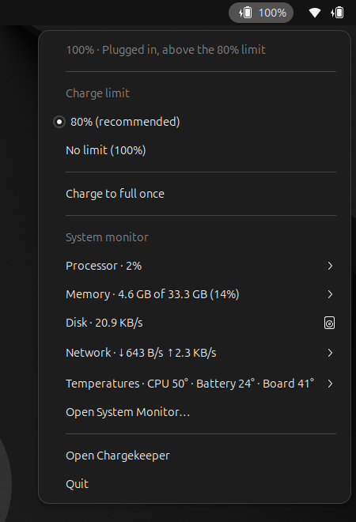
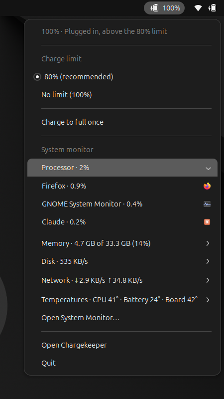
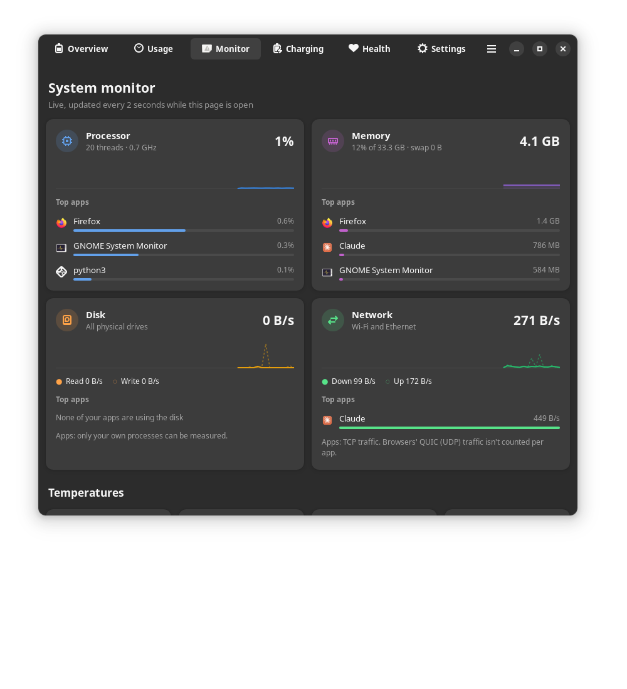

# Chargekeeper

Battery charge limits, health tracking and power tools for Linux laptops. GTK 4 / libadwaita app,
a small root service, and a CLI.

| Tray icon | Tray menu | Top apps |
|---|---|---|
|  |  |  |



## Install

```sh
sudo ./install.sh          # app + service
sudo ./install.sh --acer   # Acer laptops: also builds the acer-wmi-battery driver with DKMS
```

The installer pulls in dependencies with apt, dnf, pacman or zypper.

Remove with `sudo ./uninstall.sh` (add `--acer` to remove the driver too). Uninstalling switches
the limit off first.

## What it does

- **Charge limit** with a start (resume) threshold, using whatever the firmware supports:

  | Backend | Laptops | Limit |
  |---|---|---|
  | `thresholds` | ThinkPad, ASUS, Dell, Framework, MSI, Huawei, LG, Samsung Galaxy Book, System76, Toshiba | any value, plus start threshold where present |
  | `acer` | Acer (via [acer-wmi-battery](https://github.com/frederik-h/acer-wmi-battery)) | fixed 80% |
  | `ideapad` | Lenovo IdeaPad/Legion conservation mode | fixed (80% or 60%, model dependent) |
  | `samsung` | older Samsung | fixed 80% |
  | `sony` | Sony VAIO | 50 / 80 / 100% |
  | `software` | firmware that can pause charging (`charge_behaviour`) but has no threshold | any value, enforced by the service |
  | none | everything else | unplug reminder notification at your chosen level |

  A requested limit the firmware can't do is rounded **down** to the nearest supported value, so
  the battery is never charged past what you asked for. Firmware quirks are handled
  automatically:

  | Maker | Driver | Handling |
  |---|---|---|
  | Dell | `dell-laptop` | stop 55–100%, start 50–95%, stop at least 5% above start |
  | LG gram, Toshiba/Dynabook | `lg-laptop`, `toshiba_acpi` | only 80% or 100% are accepted, so the limit is fixed at 80% |
  | MSI | `msi-ec` | resume level is always 10% below the limit; start is never written (writing it moves the limit) |
  | Lenovo IdeaPad/Legion | `ideapad_acpi` | conservation mode, 60–80% depending on the model |

  If firmware rejects a value anyway, the error says so and suggests 80%. Some ASUS models only
  honour 60, 80 or 100% even though the kernel accepts any value.
- **Charge to full**: one button on the Overview (and in the tray) lifts the limit until you
  unplug, then restores it. If you never unplug, the limit comes back 6 hours after the battery is
  full, so it doesn't sit at 100% for days.
- **Pause charging / run on battery while plugged in**, where the kernel exposes `charge_behaviour`.
- **Charging mode** (Standard, Adaptive, Long Life, …) on Dell and others with `charge_types`.
- **Calibration** on Acer. It switches itself off when the firmware finishes, when the charger is
  unplugged, or after 24 hours at the latest.
- **Health**: full-charge vs design capacity, wear, cycles, temperature, a daily health history.
- **History charts** of charge level (with plugged-in periods) and power draw: 6 h, 24 h, 7 days.
- **Usage**: time on battery, battery and energy used, average power and expected runtime, time on
  the charger, and which apps used the most processor time while on battery (today or 7 days).
  The service reads `/proc` once a minute; nothing is recorded while plugged in.
- **Tray icon**: battery level in the top bar. Click it for a menu with the current state, the
  charge limit (60–90% or no limit), **Charge to full once**, a **System monitor** section
  (processor, memory, disk, network and temperatures, each opening a submenu with the top three
  apps), and Open / Quit. The monitor section measures when the menu opens (a fresh reading within
  a second) and refreshes every 2 s while it stays open; nothing runs while it's closed. Turn it
  on under Settings → Tray icon; it starts at login. It uses the StatusNotifierItem protocol: KDE, Cinnamon,
  XFCE and others show it natively, GNOME needs the AppIndicator extension (Ubuntu ships it; the
  app offers to enable it).
- **Monitor**: live processor, memory, disk and network use with a 2-minute sparkline and the
  top 3 apps in each, plus CPU, battery, motherboard, SSD and GPU temperatures and a list of every
  sensor. It samples every 2 s only while the page is open (about 1% of one core). Memory per app
  is private memory (resident minus shared), as GNOME System Monitor shows it. Temperatures are
  classified per reading, so mixed embedded-controller chips (Dell `dell_smm`, Framework `cros_ec`,
  ThinkPad, HP) and ARM laptops (`cpu*_thermal`) get the right CPU, battery and board values; on
  Ryzen, `Tdie` is preferred over the offset `Tctl`. Per-app disk
  use covers your own processes; per-app network use covers TCP connections (QUIC/UDP isn't
  attributed). SSD temperatures are read at most every 30 s, since each read wakes the drive.
- **Notifications**: unplug reminder, limit reached, top-up done, low battery, battery too hot.
- **Power**: power-profiles-daemon mode, firmware platform profile, CPU energy preference.
- **Re-applies settings** every 30 s (10 s for the software limit) and after resume, for firmware
  that forgets them.
- **Safety**: "pause charging" and "run on battery" switch back to normal charging when the
  battery drops to 20% or the charger is unplugged, and when the service stops.
- **Diagnostics**: detects missing drivers and conflicting TLP thresholds, copies a report.

## CLI

```
chargekeeper status
chargekeeper limit 85        # or: off
chargekeeper full            # charge to 100% once (alias: topup)
chargekeeper calibrate on    # Acer
```

## Layout

| Path | What |
|---|---|
| `/usr/lib/chargekeeper/` | Python package and `chargekeeper-helper` (root) |
| `/etc/chargekeeper/config.json` | limit settings (system-wide) |
| `/var/lib/chargekeeper/` | history, health and app usage logs |
| `~/.config/chargekeeper/prefs.json` | notification preferences (per user) |

The app runs as your user. Changes go through `pkexec chargekeeper-helper`. A polkit rule lets
administrators (`sudo`, `wheel` or `admin` group) at the local, active seat change battery settings
without a password; other users are asked for an administrator password. The helper only accepts
validated values (percentages and choices the firmware lists).

## Tests

```sh
python3 -m unittest discover tests
```
