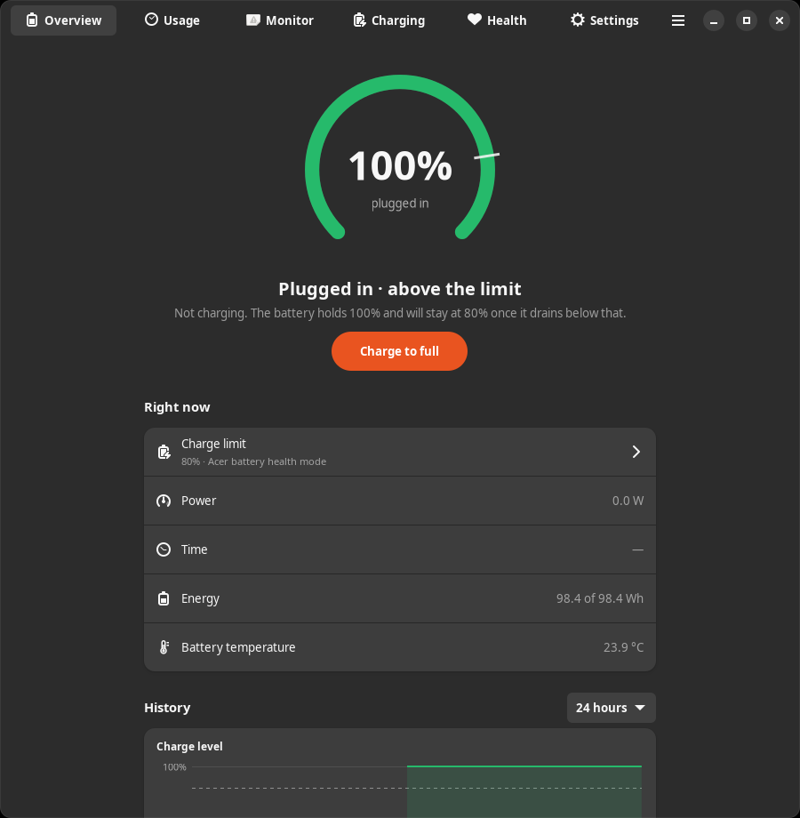
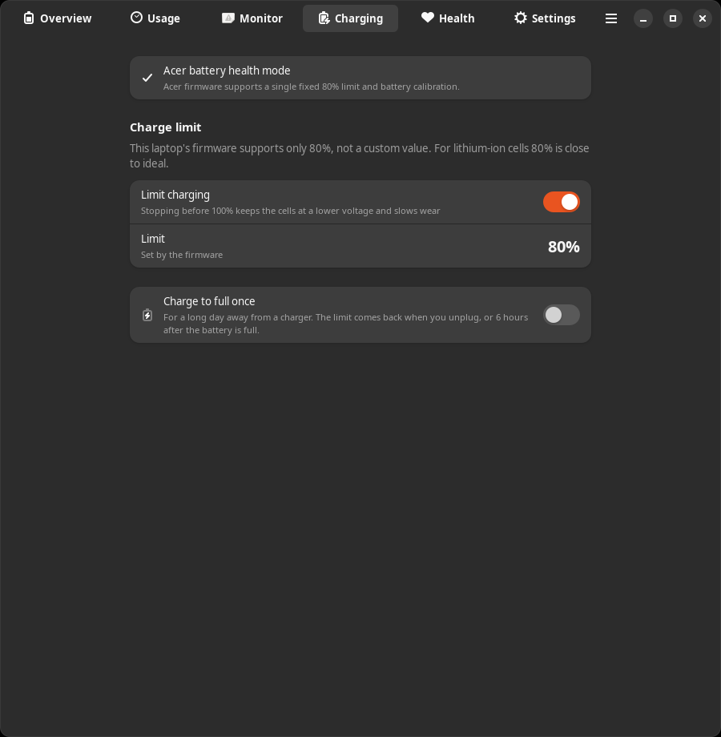
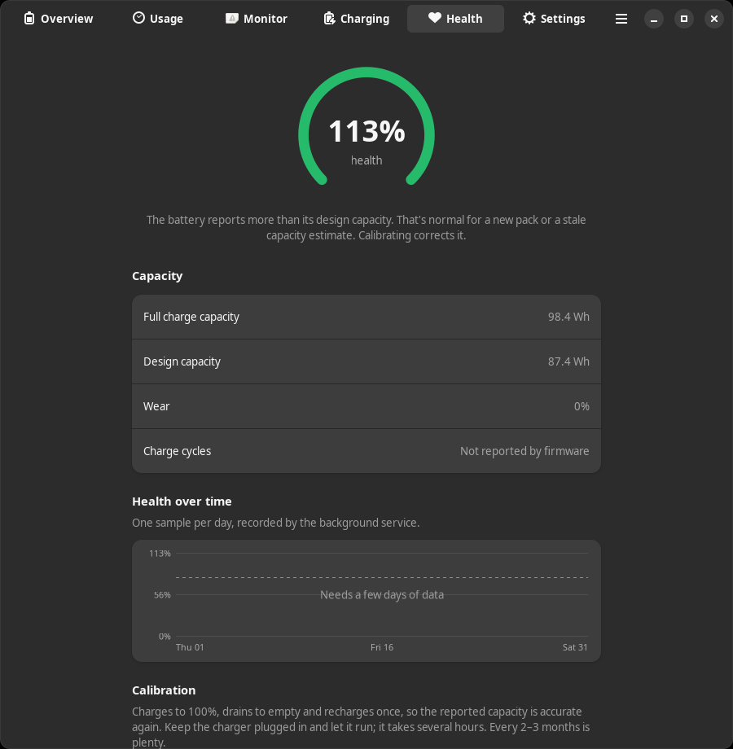
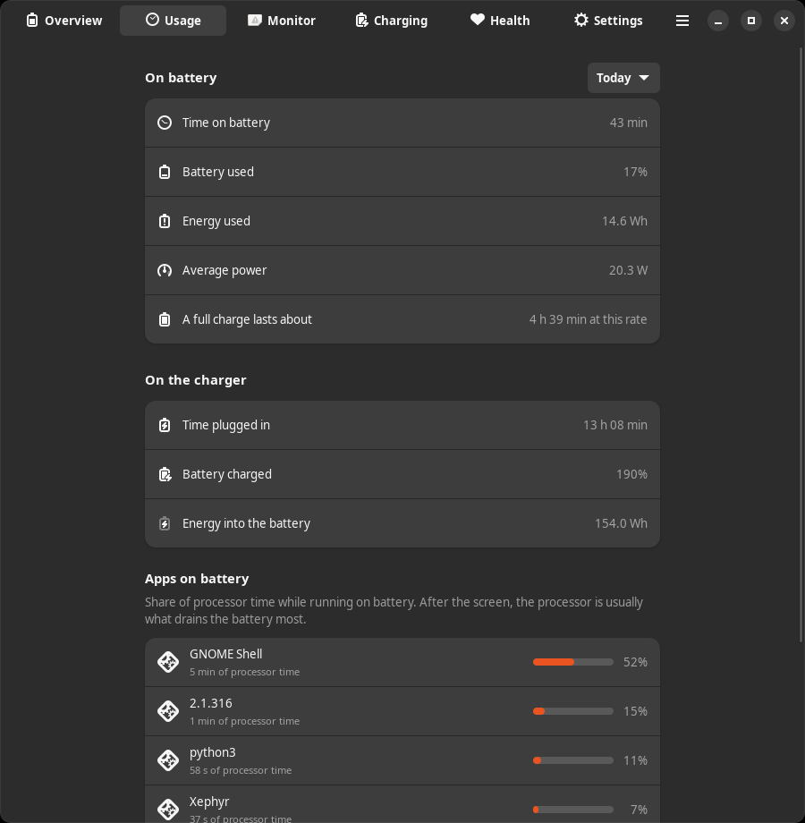
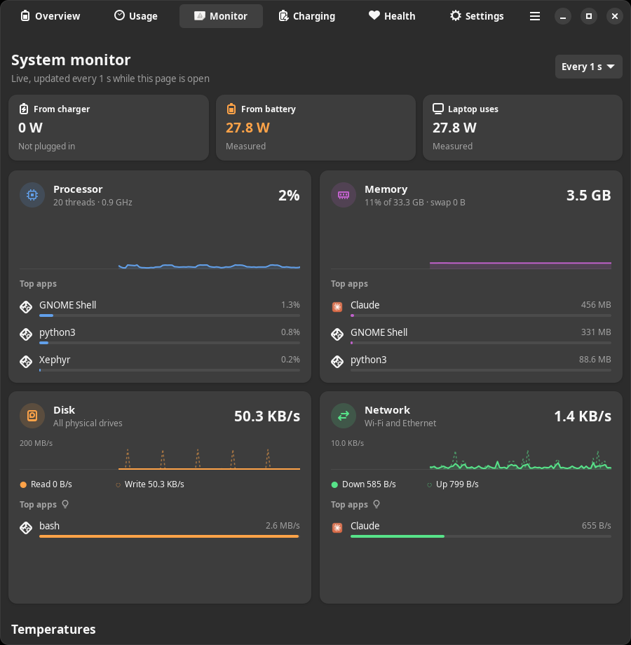
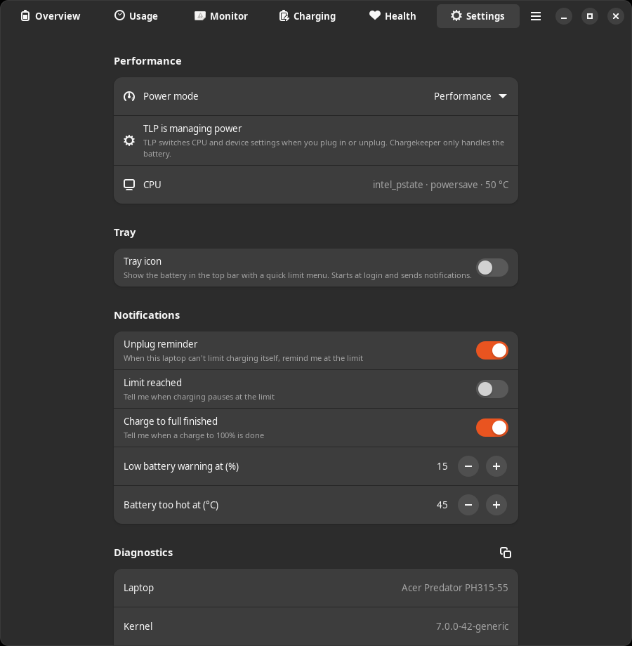
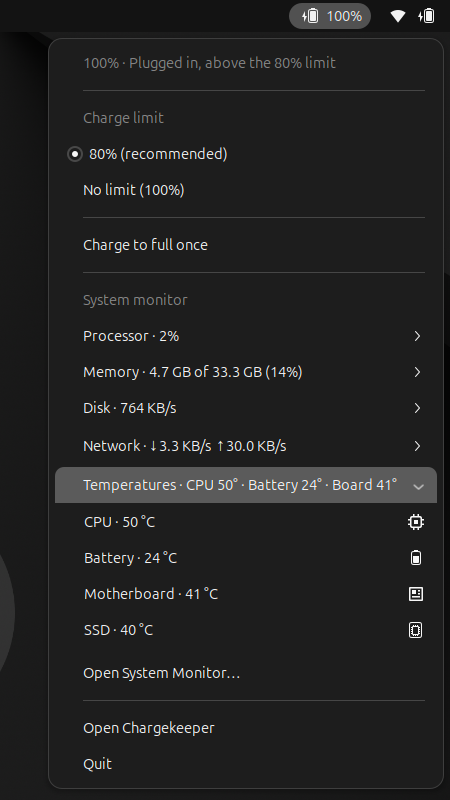

# Chargekeeper

Battery charge limits, battery health, usage history and a live system monitor for Linux laptops.
Chargekeeper stops charging at a level you choose (80% by default on most laptops) so the battery
lasts longer, and shows what is using your battery. It is a GTK 4 / libadwaita app with a tray
icon, a small background service and a command-line tool.



**Contents:**
[Screenshots](#screenshots) ·
[Features](#features) ·
[Supported laptops](#supported-laptops) ·
[Install](#install) ·
[Using it](#using-it) ·
[How it works](#how-it-works) ·
[Safety and precautions](#safety-and-precautions) ·
[What doesn't work](#what-doesnt-work) ·
[Troubleshooting](#troubleshooting) ·
[Uninstall](#uninstall)

## Screenshots

All screenshots are of the real app on an Acer Predator with Ubuntu 24.04 (GNOME 46, dark style).

| Overview | Charging |
|---|---|
|  |  |
| **Health** | **Usage** |
|  |  |
| **Monitor** | **Settings** |
|  |  |

**Tray icon.** The battery level stays in the top bar. Click it for a quick menu: change the limit,
charge to full once, and see the system monitor with the top apps in each category.

| In the top bar | Clicked | Processor opened | Temperatures opened |
|---|---|---|---|
|  |  |  |  |

## Features

**Charging**
- **Charge limit** with a resume level, using whatever your laptop's firmware supports (see
  [Supported laptops](#supported-laptops)). The limit is enforced by the firmware, so it works even
  when the app is closed or the laptop is asleep.
- **Charge to full**: one click on the Overview or in the tray charges to 100% once. The limit comes
  back when you unplug, or 6 hours after the battery is full if you never do.
- **Pause charging** or **run on battery while plugged in**, where the firmware supports it.
- **Charging mode** (Standard, Adaptive, Long Life, ...) on Dell and other laptops that offer it.
- **Calibration** on Acer, which switches itself off when done.

**Battery information**
- Live level, power, time remaining, energy and temperature, updated as they change.
- Health: full-charge capacity against design capacity, wear, charge cycles, and a daily health
  history.
- Charts of charge level (with plugged-in periods) and power draw over 6 hours, 24 hours or 7 days.
- Usage: time on battery, battery and energy used, average power, how long a full charge lasts,
  and which apps used the most processor time while on battery.

**System monitor**
- Processor, memory, disk and network use with a 2-minute graph and the **top 3 apps** in each.
- Temperatures: CPU, battery, motherboard, SSD and GPU, plus every sensor the laptop has.
- Also in the tray menu, with the top apps in a submenu for each category.

**Everything else**
- Tray icon with a quick menu; it starts at login if you turn it on.
- Notifications: unplug reminder, limit reached, charge to full finished, low battery, battery too
  hot.
- Power mode (power-profiles-daemon), firmware performance profile and CPU energy preference.
- Diagnostics: detects missing drivers and conflicting tools, and copies a report for bug reports.
- Command-line tool for scripts and terminals.

## Supported laptops

Chargekeeper uses the charge-control interface the Linux kernel exposes for your laptop. Which one
you get depends on the maker and model:

| Laptops | Kernel interface | What you can set |
|---|---|---|
| ThinkPad, ASUS, Dell, Framework, Huawei, Samsung Galaxy Book, System76, MSI, LG gram, Toshiba | charge thresholds | any limit, and a resume level where the firmware has one (exceptions below) |
| Acer | [acer-wmi-battery](https://github.com/frederik-h/acer-wmi-battery) driver, built by the installer | 80% on or off; battery calibration |
| Lenovo IdeaPad, Legion, Yoga | conservation mode | on or off; holds 60% or 80% depending on the model |
| Older Samsung | battery life extender | 80% on or off |
| Sony VAIO | battery care limiter | 50%, 80% or 100% |
| Laptops that can pause charging but have no threshold | `charge_behaviour` | any limit; the background service pauses and resumes charging |
| Everything else (most HP, Microsoft Surface, Razer, Gigabyte) | none | an **unplug reminder** notification at your chosen level |

A limit the firmware can't do is rounded **down** to the nearest supported value, so the battery
is never charged past what you asked for. Known firmware rules are applied automatically:

| Maker | Rule |
|---|---|
| Dell | limit 55–100%, resume level 50–95%, limit at least 5% above the resume level |
| LG gram, Toshiba/Dynabook | only 80% or 100% are accepted, so the limit is 80% |
| MSI | the resume level is always 10% below the limit; Chargekeeper only sets the limit |
| Lenovo IdeaPad/Legion | conservation mode holds 60–80%, depending on the model |
| ASUS | the kernel accepts any value, but some models only honour 60%, 80% or 100% |

To see what your laptop supports, install Chargekeeper and run `chargekeeper status`, or open the
Charging tab. The first row names the interface it found.

## Install

### Requirements

- A Linux distribution with **GTK 4.14+** and **libadwaita 1.5+**: Ubuntu 24.04 or newer, Debian 13,
  Fedora 40 or newer, Arch Linux, openSUSE Tumbleweed.
- Python 3.10+, PyGObject, polkit and systemd (all standard on these distributions).

### Steps

1. Download this repository (or `git clone` it) and open a terminal in its folder.
2. Run the installer:

   ```sh
   sudo ./install.sh
   ```

   It installs any missing dependencies with apt, dnf, pacman or zypper, copies the app to
   `/usr/lib/chargekeeper`, and starts the background service. On a first install it sets an 85%
   limit (rounded down to what your laptop supports, for example 80% on Acer).

   **Acer laptops** need an extra driver. Run this instead:

   ```sh
   sudo ./install.sh --acer
   ```

   This builds [acer-wmi-battery](https://github.com/frederik-h/acer-wmi-battery) at a pinned
   version with DKMS, so it is rebuilt automatically for new kernels. With **Secure Boot** on, the
   module must be signed. Ubuntu's DKMS signs it with a machine key; if that key isn't enrolled
   yet, you're asked for a one-time password and must confirm the key (MOK) on the next reboot.
   Other distributions need their own module-signing setup.
3. Open **Chargekeeper** from the app menu, or run `chargekeeper`.

To update, download the new version and run `sudo ./install.sh` again. Your settings are kept.

### Tray icon

Turn it on in **Settings → Tray icon**. It starts at login from then on.

- **KDE Plasma, Cinnamon, XFCE, MATE, Budgie:** works as is.
- **GNOME (including Ubuntu):** needs the AppIndicator extension. Ubuntu ships it; if it's switched
  off, the Settings tab shows an **Enable** button. On other distributions install
  [AppIndicator and KStatusNotifierItem Support](https://extensions.gnome.org/extension/615/appindicator-support/).

## Using it

**Set the limit.** On the **Charging** tab, switch on **Limit charging** and pick a level (or use the
tray menu). 80% is a good everyday choice for lithium-ion batteries. Where the firmware supports a
resume level, charging restarts only once the battery drops below it, so the charger doesn't top up
constantly.

**Charge to full before a trip.** Press **Charge to full** on the Overview, or check **Charge to full
once** in the tray. The limit comes back by itself.

**Leaving it plugged in.** When the battery is above the limit, the laptop runs from the charger
and the battery slowly settles back to the limit. "Plugged in · above the limit" on the Overview is
normal.

**Command line.**

```
$ chargekeeper status
Battery     BAT1  100%  Full
Adapter     plugged in
Power       0.0 W
Health      113%  (98.4 of 87.4 Wh design)
Temperature 23.9 °C

Control     Acer battery health mode
Limit       80%

$ chargekeeper limit 85        # set the limit (or: off)
$ chargekeeper full            # charge to 100% once
$ chargekeeper calibrate on    # Acer only
```

Running `chargekeeper` with no arguments opens the app; in a terminal without a display it prints
the status.

## How it works

```
 You (GTK app, tray, CLI)  ──pkexec──▶  chargekeeper-helper (root)  ──▶  firmware via /sys
         │                                         ▲
         │ reads /sys and /proc                    │ same program, run by systemd
         ▼                                         │
  live readings, monitor              chargekeeper.service: re-applies the limit,
                                      enforces the software limit, logs history
```

- The **app runs as your user** and only reads. Every change goes through `chargekeeper-helper`,
  which runs as root through polkit and accepts only checked values: percentages in range and
  choices the firmware itself lists.
- The **background service** re-applies your settings after boot, resume and charger changes (some
  firmware forgets them), enforces the limit on laptops without a firmware threshold, records
  history once a minute, and stops calibration and charge-to-full when they're done.

### Live readings without wasting battery

Measuring the battery shouldn't drain it. Chargekeeper keeps readings current like this:

1. **Kernel events.** Battery and charger drivers announce changes (charger plugged in or out,
   charging started or stopped, and on most laptops every 1% step). The app and the service listen
   for these events, which needs no polling and no privileges, and react within 0.15 seconds.
2. **One cheap read.** A reading parses each battery's single `uevent` file instead of about 20
   separate files: 0.11 ms in total. Slow sensors are cached. On Acer, the battery temperature
   alone is a 4 ms firmware call, so it's read at most every 30 seconds.
3. **Polling only while you're looking.** While the window or the tray menu is open, numbers refresh
   every 2 seconds. Otherwise there is only a 60-second check for firmware that sends no events.
   The kernel caches battery values for 1 second anyway, so faster polling would gain nothing.
4. **Time remaining from your recent use.** The estimate divides the stored energy by your
   average power over the last 3 minutes, which follows a real change in what you're doing but
   ignores short spikes. It restarts when you plug in or unplug. The 3-minute window was chosen
   by simulating mixed use, gaming then idle, and steady work against 1- and 10-minute averages,
   the session average and last week's typical use: it had the lowest error (14.5% on average
   versus 16.0% for a 1-minute average; 4.3% for steady work). When your current load would give
   a noticeably different answer, the Overview shows that too ("2 h 10 min at the current load").
   Charging time allows for the slower charging above 80%. If the firmware doesn't report power,
   it's calculated from the change in stored energy.
5. **The service sleeps** until a kernel event or its next deadline: 60 s normally, 30 s during
   calibration or charge to full. On laptops where the service itself enforces the limit, it checks
   every 20 s while charging and every 5 s within 3% of the limit, so charging stops on time.

Measured over 10 minutes on an Acer Predator PH315-55 (20 threads), all running at once:

| Running | CPU (share of one core) | Wakeups | Memory |
|---|---|---|---|
| Background service | **0.017%** (0.05 s of CPU in 5 min) | 1 per minute | 11 MB |
| Tray icon, menu closed | **0.015%** (0.09 s in 10 min) | 1 per minute | 138 MB resident, 50 MB of it its own |
| Window open, live numbers every 2 s | 0.16% (0.94 s in 10 min) | 50 per minute | 76 MB |
| Monitor tab or tray menu open | about 1.2–1.4% | only while open | |

Together the service and tray use roughly 1–2 milliwatts, around 0.002% of a typical laptop
battery per hour. Most of the tray's memory is GTK and libadwaita, shared with other GTK apps.
Memory stays flat over time: the 10-minute run, 600 tray-menu openings, 40 window reopenings and
3,000 service cycles showed no growth.

## Safety and precautions

Chargekeeper is designed so that a mistake or a crash leaves your laptop charging normally:

- **Rounding is always down.** You're never charged above the limit you chose.
- **"Pause charging" and "Run on battery while plugged in" switch off by themselves** when the battery
  falls to 20% or the charger is unplugged, so a forgotten setting can't run a plugged-in laptop
  flat.
- **If the service stops or crashes**, it sets charging back to normal on the way out. Uninstalling
  switches the limit off first.
- **Calibration and charge to full end on their own:** calibration when the firmware finishes, on
  unplug, or after 24 hours; charge to full on unplug or 6 hours after reaching 100%.
- **Only values the firmware accepts are written.** Known firmware rules (Dell, LG, Toshiba, MSI)
  are applied before writing. A rejected value shows an error instead of being retried with
  something else.
- **Administrators at the laptop change settings without a password.** Other users are asked for
  an administrator password (polkit).
- **Nothing leaves your computer.** No network access, no telemetry. History stays in
  `/var/lib/chargekeeper`.

Precautions:

- **Use one charge-limit tool at a time.** TLP's `START/STOP_CHARGE_THRESH`, GNOME's **Preserve
  Battery Health** (GNOME 48+), KDE's **Battery charge limit**, and vendor tools all write the same
  firmware setting and will fight. Chargekeeper warns about TLP; switch the others off yourself.
- **A limit isn't instant if the battery is already above it.** The laptop stops charging and the
  battery drains to the limit through normal use. It doesn't discharge on purpose while plugged
  in.
- **Calibration takes several hours** and runs the battery from full to empty and back. Keep the
  charger connected, and don't calibrate more than every 2–3 months.
- **The Acer driver is third-party** (built from source at a pinned version). The installer only
  builds it when you pass `--acer`.
- The power mode, firmware profile and CPU energy settings on the Settings tab change performance
  and fan behaviour, not charging. TLP or power-profiles-daemon may override them.

## What doesn't work

- **Laptops without a kernel charge-control interface** can't limit charging: most HP models,
  Microsoft Surface, Razer, Gigabyte, and some budget brands. Chargekeeper detects this and offers
  an unplug reminder instead. Support depends on the kernel, so a newer kernel may add your model.
- **Desktop computers** have no battery. The Monitor tab still works.
- **Per-app disk use** covers only your own apps; Linux keeps other users' and system services'
  counters private. The disk total is complete.
- **Per-app network use** covers TCP connections. Browsers' QUIC (UDP) traffic counts in the total
  but isn't credited to an app.
- **NVIDIA proprietary driver** GPU temperatures aren't shown (they aren't exposed through the
  kernel's sensor interface). AMD, Intel and nouveau GPUs work.
- **The tray icon on GNOME** needs the AppIndicator extension.
- **Battery temperature** isn't available on laptops whose firmware doesn't report it.
- **Charge cycles** show "Not reported" when the firmware leaves them at 0 (common on Acer).
- **Battery health above 100%** is a firmware estimate, often seen on new batteries. Calibration (on
  Acer) corrects it.
- Not packaged as Flatpak or Snap: changing firmware settings needs a root helper, which those
  sandboxes don't allow.

## Troubleshooting

| Problem | What to do |
|---|---|
| Banner: "Background service is not running" | `sudo systemctl enable --now chargekeeper`, or run `sudo ./install.sh` again. |
| "The firmware does not accept 85%" | Your model only takes certain values. Choose 80%. |
| The limit resets after a reboot | Make sure the service is running (above), and that TLP or another tool isn't setting thresholds. |
| No tray icon on GNOME | Settings tab → **Enable** next to the warning, or turn on the AppIndicator extension. |
| Acer: "battery driver not installed" | `sudo ./install.sh --acer`. With Secure Boot, complete the MOK enrollment at the next boot. |
| Charging stopped at a strange level on MSI | Update; MSI's resume level is now handled correctly. |
| Anything else | Settings tab → Diagnostics → copy button, and include the report in a bug report. Service log: `journalctl -u chargekeeper`. |

## Uninstall

```sh
sudo ./uninstall.sh          # keeps the Acer driver
sudo ./uninstall.sh --acer   # also removes the Acer driver
```

Uninstalling switches the limit off, so the battery charges to 100% again, and sets charging back
to normal. Your notification preferences stay in `~/.config/chargekeeper`; delete that folder too if
you want.

## Files

| Path | What |
|---|---|
| `/usr/lib/chargekeeper/` | the app and `chargekeeper-helper` |
| `/etc/chargekeeper/config.json` | limit settings (system-wide) |
| `/var/lib/chargekeeper/` | history, health and app usage logs |
| `/run/chargekeeper/state.json` | service status, read by the app |
| `~/.config/chargekeeper/prefs.json` | notification and tray preferences (per user) |
| `/usr/share/polkit-1/` | permission policy and rule |

## Development

```sh
python3 -m unittest discover tests     # 46 tests, no root needed
tools/run_app.py                       # run the app from the source tree
tools/run_app.py --tray                # ...in background mode with the tray icon
tools/soak.sh 600                      # CPU, wakeups and memory over 10 minutes
```

Before changing the app, read [MAINTAINING.md](MAINTAINING.md): how it fits together, the rules
learned from past bugs, and the checks before every commit. Changes are listed in
[CHANGELOG.md](CHANGELOG.md).

| Module | Purpose |
|---|---|
| `core.py` | batteries, firmware interfaces, settings, history |
| `power.py` | kernel events and the live battery reading |
| `helper.py` | root helper and background service |
| `gui.py`, `monitor_page.py` | the app window |
| `tray.py` | tray icon and menu (StatusNotifierItem over D-Bus) |
| `monitor.py` | processor, memory, disk, network and temperature readings |
| `cli.py` | command line |

## License

GPL-3.0-or-later. See [LICENSE](LICENSE).
